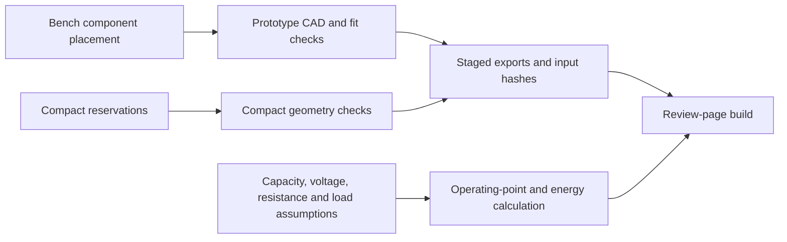

# Connecting a power model to physical space

Spark has two engineering questions that must remain separate. Can the proposed parts occupy the enclosure, and can the electrical system deliver the requested power within its operating limits? A rendered assembly answers neither by itself. The public code makes those questions inspectable through a component contract, geometry validation and an energy model.

The explanations below trace the implementation. Tradeoff rationales are inferred from the code and its declared assumptions. They are not measured converter results or a history of design decisions.

## From component data to a review page

The bench board's [`component-placement.json`](electronics/boost-prototype/component-placement.json) describes component bounds, side, height and whether an item is a PCB feature. [`component_references()`](mechanical/build_model.py) reads that data, checks the board dimensions against the mechanical model, rejects invalid or duplicate references and creates the corresponding CAD bodies. Where a body height is absent, the code names the result an unmeasured reference instead of silently treating it as a measured component.

`export_all()` builds the enclosure, validates parts, checks the enclosure and sleeve-removal path, then writes exports into a temporary staging directory. It hashes the inputs before publishing and checks them again afterwards. A source file changing during export must not produce a report that certifies a mixture of revisions.

[`publish_files()`](mechanical/publish_assets.py) keeps backups of destinations, replaces the generated outputs and restores changed files when publication raises an exception. If restoration itself fails, it retains the recovery directory and reports its location. This is recoverable multi-file publication. Individual file replacements do not make the entire directory switch atomic for a concurrent reader, and this code does not establish durability through arbitrary power loss.

[`review/build.mjs`](review/build.mjs) consumes the exported GLB, mechanical contract, circuit data and compact-layout data. It builds the parts and comparison pages and records source/output hashes. The review UI is therefore tied to engineering inputs instead of maintaining a separate hand-entered list of dimensions.



The compact design uses a different contract. [`validate_layout()`](mechanical/build_compact_model.py) checks each board-face reservation, its thickness bounds, display intersection and same-face overlap. Capacitor populations must fit the declared site area. Zero overlaps means nominal boxes fit. It does not establish land patterns, copper routing, solder clearance, tolerance accumulation or thermal performance.

## Why the current equation is quadratic

[`calculatePerformance()`](review/performance-model.mjs) starts with requested USB output power `Pout` and boost efficiency `η`. The converter needs `Pin = Pout / η` at its input. A cell with open-circuit voltage `Voc` and series resistance `R` delivers terminal voltage `Vloaded = Voc − I R`.

Combining those gives:

```text
Pin = I × Vloaded = I × Voc − I² R
R I² − Voc I + Pin = 0
D = Voc² − 4 R Pin
I = 2 Pin / (Voc + sqrt(D))
```

The implementation uses this last form for the lower-current solution. It avoids subtracting two nearly equal numbers and also works at `R = 0` without dividing by zero. Selecting this algebraic branch does not demonstrate that a physical regulator is dynamically stable.

If `D` is negative, the fixed-voltage/resistance model has no real operating point and returns `power-limit`. If the loaded voltage reaches the cutoff, it returns `voltage-cutoff`. In either case, runtime and phone-energy outputs become `null`. An infeasible case must not appear as a useful charging estimate.

For a feasible point, the model computes resistance loss `I²R`, converter loss `Pin − Pout` and total cell depletion `Pin + I²R`. It divides usable stored energy by that depletion rate, then subtracts phone activity from the energy that reaches the phone after charging loss.

## A worked energy balance

The independently solved example in [`performance-model.test.mjs`](review/performance-model.test.mjs) uses a 250 mAh cell, 4 V nominal and open-circuit voltage, 0.1 Ω series resistance, 6.84 W output, 90% boost efficiency and 100% usable-energy fraction. These are test inputs, not a selected battery or a measured operating point.

- Stored energy is `0.250 Ah × 4 V = 1 Wh`.
- Converter input is `6.84 W / 0.90 = 7.6 W`.
- The discriminant is `4² − 4 × 0.1 × 7.6 = 12.96 V²`.
- Current is `15.2 / (4 + 3.6) = 2 A`.
- Loaded voltage is `4 − 2 × 0.1 = 3.8 V`, above the assumed 3.2 V cutoff.
- Resistive loss is `2² × 0.1 = 0.4 W`; converter loss is `0.76 W`.
- Cell depletion is `8 W`, so the constant-point runtime is `1 Wh / 8 W = 0.125 h`, or 7.5 minutes.

Over that interval, USB energy is 0.855 Wh, converter loss is 0.095 Wh and resistance loss is 0.050 Wh. Their sum is exactly the assumed 1 Wh. With the default 85% phone charging efficiency and zero phone activity, stored phone energy becomes 0.72675 Wh. Dividing by the model's 16.76 Wh phone reference gives about 4.34 percentage points. This last number describes the model's reference, not compatibility with a particular phone.

## Tradeoffs and their costs

**A constant operating point makes assumptions inspectable but cannot predict a discharge curve.** The function keeps voltage, resistance and efficiencies fixed. A time-stepped model could include state of charge, changing resistance and thermal derating, but needs measured curves and validated parameters. Adding more state without those measurements would add detail without evidence. The current result must not be presented as temperature or full-charge-time prediction.

**Capacity and output wattage answer different questions.** Raising output power can shorten runtime while increasing resistive loss. It does not increase the cell's stored watt-hours. `targetReachable` requires positive net phone-charging power and enough net energy, with a scale-relative floating-point tolerance. A short charging-time number is suppressed when the requested energy cannot be delivered.

**Populating both board faces saves planar area but consumes thickness and assembly clearance.** The compact validator checks front and back extents separately and tests collision with the display. This can admit a nominal packing that is still impossible to route or assemble. The alternative, more area on one face, can enlarge the enclosure but may simplify component access and thermal layout. The repository does not yet contain the measurements needed to choose between those production outcomes.

**Hash-bound exports cost rebuild time but expose stale presentation artifacts.** Input/output hashes and staging address a specific failure: a review page describing geometry from a different source revision. Hashes prove byte correspondence, not electrical correctness. Retaining a report for a missing binary export does not reproduce that export; the build instructions regenerate it.

## Evidence and the next experiment

The performance tests check conservation, zero resistance, an independently solved current, negative/invalid inputs and cutoff states. Compact-model tests reject board-boundary and thickness violations. Publication tests inject replacement failures. The display tests require explicit simulated telemetry, so a polished screen cannot imply measured battery health. These tests validate formulas and software contracts; they do not qualify the boost board or a complete USB-C power bank.

A proposed next electrical experiment uses the bench converter with an isolated, current-limited supply and electronic load, before a battery or phone. Set the supply current limit to 1.5 A. At 5 V output, test 0.1, 0.25 and 0.5 A loads at each of 3.3, 3.8 and 4.2 V input, holding each of the nine points for 60 seconds. Record input/output voltage and current, component temperatures and the output waveform. Propose output within ±5% of 5 V, peak-to-peak ripple below 100 mV at a documented 20 MHz measurement bandwidth, and no protection event at those points as the first gate. Compare measured efficiency with the model's assumed 90%; replace that assumption with a measured map where it differs. This proposed gate is limited to those bench conditions. USB-PD negotiation, charging, independent cell protection and 25 W operation require separate implementation and tests.
