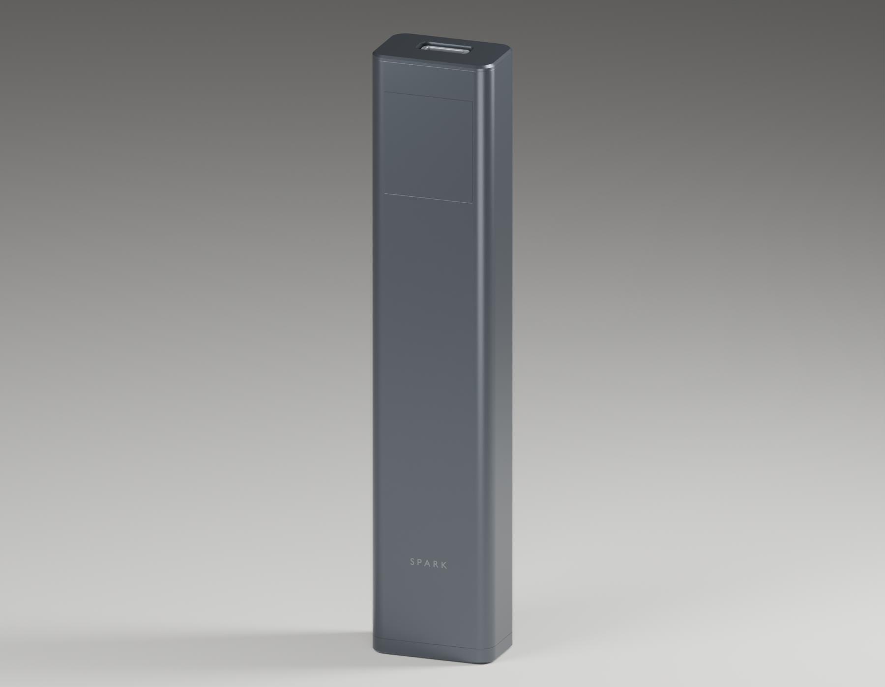

# Spark

A compact power-bank development project that connects enclosure CAD, circuit design, component placement and an interactive review UI. The work currently includes a routed bench boost-converter PCB and several compact packaging studies.

The CAD checks component reservations. The power model solves current, voltage sag and energy loss. [The engineering walkthrough](ENGINEERING.md) derives the equations and identifies the missing measurements.



*Existing CAD render of Prototype A. It shows the intended enclosure; it is not a tested consumer power bank.*

## Open the hardware files

| File | Contents |
| --- | --- |
| [Assembly STEP](mechanical/exports/spark_assembly.step) | Prototype A enclosure and component reservations |
| [Print STLs](mechanical/print_parts/) | Sleeve, carrier, front cover and bottom cap for fit prototypes |
| [Compact STEP models](mechanical/compact-exports/) | Separate 300, 530 and 850 mAh packing studies |
| [KiCad schematic](electronics/boost-prototype/spark_boost_rev_a.kicad_sch) and [PDF](electronics/boost-prototype/reports/schematic.pdf) | TPS61288 bench boost circuit |
| [KiCad board](electronics/boost-prototype/spark_boost_rev_a.kicad_pcb) and [board preview](electronics/boost-prototype/preview/pcb-front.svg) | Routed four-layer bench board |
| [Board BOM](electronics/boost-prototype/BOM.csv) | References, values, candidate manufacturer parts and unresolved selections |
| [Compact 850 parts](sourcing/digikey-canada-compact-850.csv) | Dated sourcing candidates and purchase conditions |
| [Gerbers and drills](electronics/boost-prototype/manufacturing-review/) | Engineering-review exports with [stackup and limits](electronics/boost-prototype/manufacturing-review/status.json) |
| [DRC report](electronics/boost-prototype/reports/pcb-drc.json) | KiCad 10.0.7 check of the included board and schematic |

The November 9 exports passed DRC with zero violations, unconnected items or schematic-parity issues; no checks were disabled. The four print meshes are connected and watertight. These are geometry and circuit-file checks, not physical fit or electrical measurements. The Gerbers describe the bench converter, not a complete battery charger or USB-C power bank.

## What is implemented

- Parametric CadQuery enclosure and internal component models.
- A four-layer 5 V/9 V boost-converter bench PCB with KiCad schematic, board, symbols and footprints.
- Compact 300, 530 and 850 mAh placement studies with dimensions checked against their component reservations.
- Three.js review code for assembly views, scale comparisons, display behavior and component inspection.
- Analytical energy and resistance models that label their assumptions and reject invalid inputs.
- Automated checks for circuit consistency, geometry, asset publication and package integrity.

## Separate the bench board from the product target

| Design | Current state |
| --- | --- |
| Prototype A | 116 x 24 x 14.8 mm enclosure study and routed bench boost PCB |
| Compact 850 | 99 x 24 x 12 mm packaging target and a 25 W electrical target |
| Compact 300/530 | Smaller cell and component-reservation studies |
| Complete phone power bank | USB-PD, charging, independent protection, temperature cutoff and final interconnects still require implementation and validation |

No measured 25 W output, charging performance or battery runtime is claimed. The converter layout and enclosure calculations do not qualify cell behavior, temperature rise or loop stability.

## Engineering work to inspect

| Path | What it contains |
| --- | --- |
| [`electronics/boost-prototype/`](electronics/boost-prototype/) | Bench schematic/PCB, placement data, generators and circuit checks |
| [`electronics/compact-design/layout.json`](electronics/compact-design/layout.json) | Compact part reservations and board-face placement |
| [`mechanical/build_model.py`](mechanical/build_model.py) | Prototype A CAD, fit checks and export generation |
| [`mechanical/build_compact_model.py`](mechanical/build_compact_model.py) | Compact placement CAD and dimension validation |
| [`review/`](review/) | Assembly viewer, interaction controls and analytical comparison UI |
| [`scripts/`](scripts/) | Verification and package-integrity tooling |
| [`sourcing/`](sourcing/) | Dated candidate parts and purchase gates |

The assembly checks distinguish physical parts from reservations. The display starts with unknown readings; simulated telemetry requires an explicit demo mode. The energy model accounts for conversion loss and resistance, and hides results when a scenario violates its limits.

## Rebuild the CAD

Use a Python environment compatible with CadQuery 2.8.0.

```sh
python -m venv .venv
.venv/bin/python -m pip install -r mechanical/requirements.txt
.venv/bin/python mechanical/build_model.py
.venv/bin/python mechanical/build_compact_model.py
```

On Windows, use `.venv\Scripts\python.exe` for the Python commands. The generators produce STEP, STL and GLB outputs from the included source. Ready-to-open STEP models, print STLs and bench-board exports are included; cached build environments are excluded.

## Check the source

```sh
.venv/bin/python -m pytest -q mechanical/test_compact_model.py mechanical/test_publish_assets.py electronics/boost-prototype/test_circuit_checks.py
cd review
npm ci
npm run test:source
```

The November 9, 2026 publication checks passed **35 selected Python tests and all 83 review Node tests**. Both CAD generators and the review-page build also completed. The 48-test Node source subset covers compact placement, display states, energy calculations, fit summaries, motion scheduling and viewer controls. It does not require a hardware board. Full asset and packaging tests additionally require regenerated CAD, preview and render outputs.

After CAD generation, run `npm run build` in `review/` to build the review pages. Serve the repository root with `python -m http.server 8000 --bind 127.0.0.1` and open `http://127.0.0.1:8000/review/`.

The October 30 project record reports 187 Python tests, 83 Node tests and zero ERC/DRC findings for that complete local snapshot. Those historical results do not establish that every generated artifact in a fresh checkout is current. The public snapshot's validation scope is stated above.

## Next hardware work

Complete the USB-C, charging, protection and sensing circuits. Resolve actual connector and cell dimensions, then test the converter with a laboratory supply and electronic load before connecting a battery. Measure loop stability, current-path losses, temperature and fault cutoff before claiming phone-charging capability.
